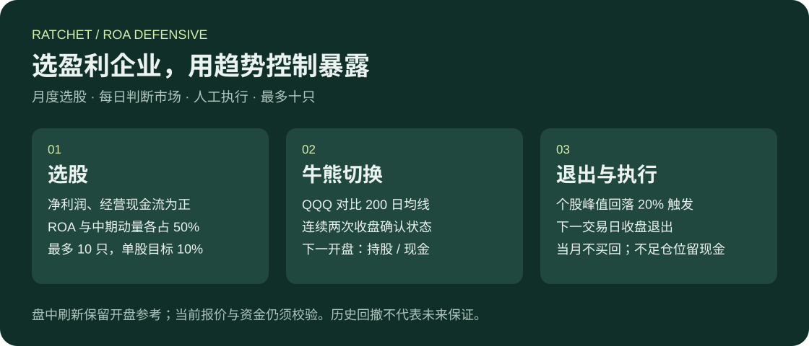
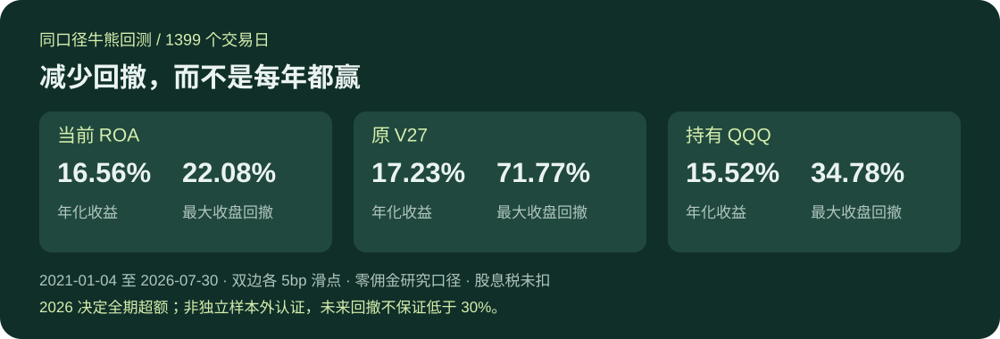

# RATCHET · 美股投资工作台

**当前策略：ROA 牛熊切换。盈利能力选股，趋势决定持股或现金，最多十只股票。**



## 历史表现



2021-01-04—2026-07-30，共1399个交易日；初始2万美元，无追加资金。整数股、股息到账再投资，买卖各计5bp滑点，佣金暂按0、股息税未扣。

| 同口径指标 | 当前 ROA | 原 V27 | 持有 QQQ |
|---|---:|---:|---:|
| 年化收益 | **16.56%** | 17.23% | 15.52% |
| 最大收盘回撤 | **22.08%** | 71.77% | 34.78% |
| 最长未创新高 | 416个交易日 | 1169个交易日 | 516个交易日 |
| 模拟成交笔数 | 503 | 169 | 3 |

**改善的是回撤；不是每年胜出，也不是全面优于V27。** 截至2025年末ROA年化约10.02%，低于QQQ的14.94%；2026年决定了全期超额。历史回撤22.08%不保证未来低于30%，盘中回撤可能更深。历史股票池与财务版本仍有时点局限，尚非独立样本外认证。

[策略规则与逐年结果](docs/STRATEGY.md) · [使用与维护](docs/OPERATIONS.md) · [实际验收状态](docs/real_event_acceptance_checklist.md) · [下一步 TODO](TODO.md)

## 日常使用

1. 打开工作台，填入券商**当前可用美元购买力**，点击“更新现金并查看建议”。
2. 查看股数、限价、建议状态和有效时间；在券商手动操作。
3. 按实际成交录入，保留未成交委托，再更新券商购买力。

盘中可以刷新；OPEN目标与限价保留开盘参考，同时校验当前行情、账户和资金。盘中延迟成交不等于回测中的开盘成交。过期建议保留供参考，不恢复为有效建议。工具不自动下单，AI新闻功能尚未证明能提高策略净收益。

## 启动与源码

```powershell
Set-Location E:\Git\us_ratchet
D:/python/python.exe -m pip install -r requirements.txt
D:/python/python.exe -B -m api.server --host 127.0.0.1 --port 8010
```

访问 <http://127.0.0.1:8010/>。已有服务时不重复启动；完整启动校验可能需要数分钟。

仓库保留当前策略、前后端、必要兼容依赖及回归验证。**私有账户、部署配置与完整历史证据不在GitHub中；新克隆不是可直接运行的实盘实例。** 运维边界和验证入口见[使用与维护](docs/OPERATIONS.md)。
