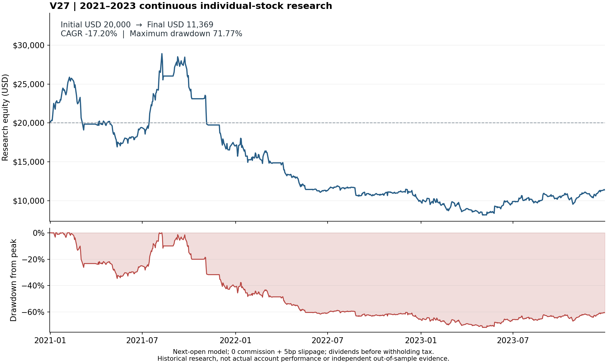

# 连续研究账户复核报告

区间：2020-12-31 至 2023-12-29；初始 $20,000.00，期末 $11,369.24。

| 年份 | 账户收益 | 年内收盘最大回撤 | QQQ价格涨跌（仅环境） |
|---|---:|---:|---:|
| 2021 | -14.83% | 42.83% | 26.81% |
| 2022 | -41.13% | 44.99% | -33.07% |
| 2023 | 13.38% | 20.85% | 53.79% |

全区间累计收益 -43.15%，年化 -17.20%（实际天数/365.25），最大收盘回撤 71.77%。

最大回撤：峰值 2021-08-09 → 谷底 2023-05-03；恢复日期：区间内未恢复。

QQQ列不含股息、交易成本，仅说明市场环境。账户结果以原研究的股息、税费及执行假设为准；年内回撤以各年初重新计算峰值。

采用同策略核心的历史次日开盘模型；不等同实盘逐笔成交，也不等同当前账户启动时点。

普通股息按官方历史金额计入，未扣投资者预提税；这是税前研究收益，不代表汇丰账户税后收益或个人税率。

## 验收结论与边界

完成的是事先冻结区间的 V27 连续个股研究基准：36 次月度选择、753 个实际执行会话，现金、股份、已暴露普通股息、选股证明及既有 20% 月内退出规则均通过独立复核。累计三笔非零 NVDA 税前股息共 1.24 美元，期末应收为零。期间不中途重置资金，不以 ETF 替代策略，不删除缺数据证券；18 次短历史资格排除按原标准保留。

**保持年化并降低最大回撤的目标尚未完成。** 该结果反驳了仅凭此前短窗口高年化即可认定跨牛熊稳健的判断。20% 月内退出不是账户最大回撤上限，月度重新买回及隔夜跳空仍会累积损失。尚无经过本轮完整对照证明优于基准的新方案上线。

使用回溯取得的公开历史数据与历史成员，不宣称完整时点数据库认证或独立样本外。价格训练信号并非完整分配总回报，MTCH、EXC 的既定特殊口径仍保留；部分 CSV 无事件流采用有明确范围的条件性证据，不冒充公司行动穷尽证明。此次实际持仓路径未触发拆股或复杂并购权益，不能据此宣称所有复杂事件模块验收完成。

固定执行假设：零佣金、单边 5bp 滑点、历史次日开盘、股息税前；保持 20,000 美元一次性初始资金。年化按实际日数/365.25；回撤使用收盘权益，不含盘中极值。当前真实账户的启动日期、人工成交及资金流不同，不能把该研究曲线描述为用户实际亏损。

## 操作代价与失败归因

| 指标 | 完整区间结果 |
|---|---:|
| 模型成交笔数 | 98 |
| 单月最高笔数 | 7（2021 年 5 月） |
| 平均日终现金 / 权益 | 38.25%（各交易日等权） |
| 最差单日收益 | -8.71%（2021-11-04） |
| 最差完整自然月 | -14.60%（2021 年 11 月） |
| 累计买卖名义金额 | $454,331.95 |
| 模型滑点成本 | $227.16（逐笔按原开盘价核对 5bp） |

11 个月目标仅一只股票，22 个月两只，2 个月三只，1 个月四只；配置上限控制单只名义比例，但没有消除行业、跳空或连续亏损。全期 MRNA 净损约 $1,096，最大回撤峰谷中 MRNA 回吐约 $10,725，这两种归因不可混用。13 段风险退出后跨月买回的持仓段合计价格交易损益约 -$5,918，但也包含约 +$7,100 的盈利 MRNA 重买段，不能据此断言禁止买回就会改善 $5,918。

2022 年市场共同下跌是环境证据，不能从单条实际账户路径精确分离“市场造成”和“个股选择造成”的因果损失。2021 年市场上涨而策略亏损，也不支持把全部问题归咎于熊市。

最长连续亏损为 2022 年 12 月至 2023 年 4 月的 5 个月，复合下跌 23.42%。2021-08-09 高点之后到区间末仍未恢复，共 602 个实际交易会话（不含峰日）；末日距高点仍低 60.67%，这与谷底最大回撤 71.77% 是不同指标。单月最差 -14.60% 也不能约束多月损失复合。新增精确证据为 v7 `loss_streak_audit.json/.md`，其生成晚于一次性归档，不覆盖原归档。

## 固定候选已按停止条件结束

新增候选只要求保存篮子的 12 个历史 21 日财富倍数全部不低于 0.80。完整基准后的零搜索审计及独立重算确认：原赢家 36 个月全部通过，最低值 0.81073，目标变化 0、现金回退 0。因此相同规则的因果执行路径不变，无需再做 36 次搜索。该候选不能改善本次回撤，已停止，不把阈值改为 0.85/0.90 继续追结果。

来源：v7 `tail_gate_feasibility.json` 与 `tail_gate_and_failure_independent_audit.json/.md`。本轮没有由这个诊断产生新的优化成绩或策略上线。

## 可复核产物

完整运行目录：`tmp/recent_continuous_baseline_20261026_v7/`。

- `book.json` SHA256：`783585ba9d4a3b88e90f8a3cf9947ecaa85ec9b2b4e5402ffde3e61a5e2b89ea`。
- `execution_inputs.json` SHA256：`62243fa46780c40e06659eee588681b791d0759d229111e2bd9e701dd70c7398`。
- `independent_prefix_review.json`：状态 `COMPLETE_DECLARED_INTERVAL_REVIEW_PASS`，无未执行月度选择；文件名沿用原部分区间复核入口，不代表此次仍为部分区间。
- `drawdown_path.json`、`verified_baseline_report.json`：回撤路径、自然年收益和全区间统计交叉验证。

复核器保守保留的 `full_bull_bear_validation=false` 不代表会话未跑全；它避免把账本复核扩大成数据时点认证、策略优化达成或实盘验收。上述完整冻结区间、数据限制与目标是否完成必须分别阅读。
