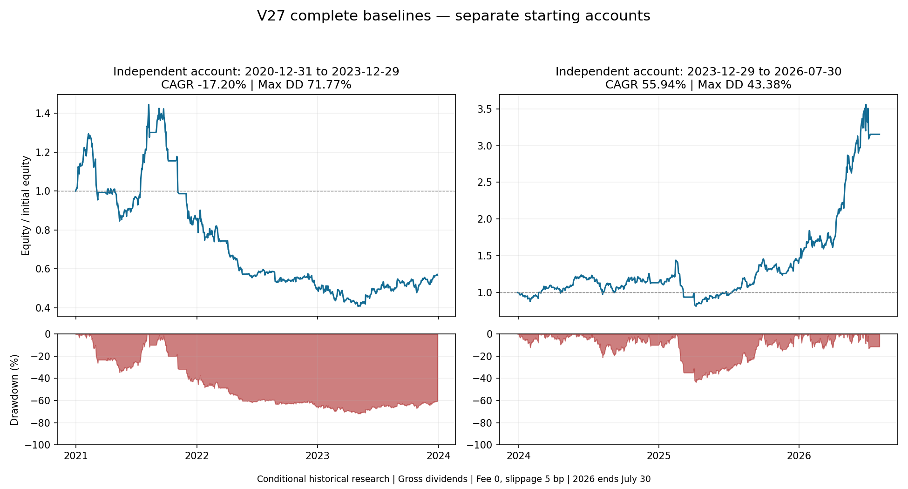

# 两个完整独立账户的 V27 连续基准

**两段均已完成独立账本复核；它们是各自从 20,000 USD 开始的账户，不能拼接为一条 2021—2026 连续收益曲线。**

| 指标 | 2021—2023 账户 | 2024—2026/7/30 账户 |
|---|---:|---:|
| 年化收益 | -17.20% | 55.94% |
| 累计收益 | -43.15% | 215.31% |
| 最大收盘回撤 | 71.77% | 43.38% |
| 期末资产 USD | 11,369.24 | 63,062.43 |
| 成交笔数 | 98 | 76 |

## 年度及部分年度

| 账户 | 年度区间 | 收益 | 年内/区间最大回撤 |
|---|---|---:|---:|
| 2021—2023 | 2021 | -14.83% | 42.83% |
| 2021—2023 | 2022 | -41.13% | 44.99% |
| 2021—2023 | 2023 | 13.38% | 20.85% |
| 2024—2026 | 2024 | 13.35% | 21.17% |
| 2024—2026 | 2025 | 23.36% | 43.38% |
| 2024—2026 | 2026（截至 7/30，非全年） | 125.51% | 13.41% |

每个图列对应独立账户，初值归一化为 1；两列不相连。图中回撤为各自全区间峰值回撤，表中年度回撤在上年末重新开始计算。

## 结果边界

- 2026 年数据截至 7 月 30 日，年度行不是全年预测；全区间年化按实际日历天数 / 365.25 计算。
- 研究模型为零手续费、5 bp 滑点及次开盘执行；普通股息按税前金额处理，不代表汇丰实际税后到账。
- 仍有历史成员、回溯身份、信号与公开数据条件性限制，不是完整时点（PIT）认证，也不是独立样本外（OOS）验证。
- 较早短窗口曾展示的约 248% 年化与这次 31 个月、完整连续账户口径不同，不能直接等同或替代。
- 后一账户收益较好不消除前一账户的重大回撤。不能据此宣称已实现“保持年化并降低最大回撤”，也不表示新优化已上线。

## 本机复核入口

- 早窗：`tmp/recent_continuous_baseline_20261026_v7/generic_complete_report_v1.json`、`book.json`、`independent_prefix_review.json`。
- 后窗：`tmp/old_continuous_baseline_20261026_v9/generic_complete_report_v1.json`、`book.json`、`independent_prefix_review.json`；完整复核来源哈希见对应 review。
- 报告生成器：`scripts/report_verified_continuous_account_v1.py`，拒绝对未完整覆盖的前缀账户年化。
