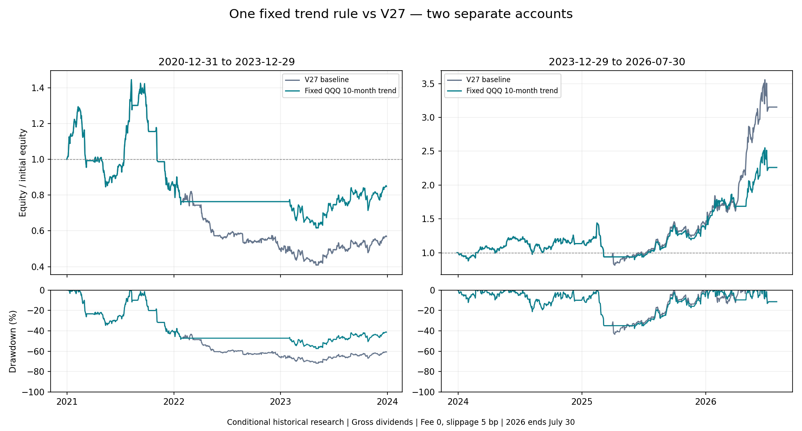

# 固定 QQQ 十月趋势规则：两段完整对照

规则固定为月末 QQQ 收盘价高于最近十个完整月末收盘价的均值时使用 V27，否则全现金；不调阈值、不追加参数扫描。账户下月次开盘执行，原单股月度退出规则保留。

| 独立账户 | 指标 | 原 V27 | 固定趋势候选 | 变化 |
|---|---|---:|---:|---:|
| 2021—2023 | 年化 | -17.20% | -5.36% | +11.84 个百分点 |
| 2021—2023 | 累计收益 | -43.15% | -15.20% | +27.95 个百分点 |
| 2021—2023 | 最大收盘回撤 | 71.77% | 57.40% | -14.37 个百分点 |
| 2021—2023 | 成交笔数 | 98 | 73 | -25 |
| 2021—2023 | 无股票会话 | 89 / 753 | 319 / 753 | +230 |
| 2021—2023 | 平均现金/权益 | 38.25% | 54.74% | +16.50 个百分点 |
| 2024—2026/7/30 | 年化 | 55.94% | 37.09% | -18.85 个百分点 |
| 2024—2026/7/30 | 累计收益 | 215.31% | 126.01% | -89.30 个百分点 |
| 2024—2026/7/30 | 最大收盘回撤 | 43.38% | 37.74% | -5.64 个百分点 |
| 2024—2026/7/30 | 成交笔数 | 76 | 62 | -14 |
| 2024—2026/7/30 | 无股票会话 | 60 / 646 | 123 / 646 | +63 |
| 2024—2026/7/30 | 平均现金/权益 | 43.41% | 51.25% | +7.84 个百分点 |

“无股票会话”按收盘 `stock_value=0` 计数；可能仍有应收股息，不能据此认定资产百分之百为可花现金。平均现金比例使用 `cash/equity`，应收股息不算现金。

| 账户 | 年度区间 | V27 收益 | 候选收益 | 变化 |
|---|---|---:|---:|---:|
| 2021—2023 | 2021 | -14.83% | -14.83% | +0.00 个百分点 |
| 2021—2023 | 2022 | -41.13% | -10.37% | +30.76 个百分点 |
| 2021—2023 | 2023 | 13.38% | 11.08% | -2.30 个百分点 |
| 2024—2026/7/30 | 2024 | 13.35% | 13.35% | +0.00 个百分点 |
| 2024—2026/7/30 | 2025 | 23.36% | 18.71% | -4.65 个百分点 |
| 2024—2026/7/30 | 2026 截至 7/30（非全年） | 125.51% | 67.98% | -57.53 个百分点 |

每列各自从 20,000 USD 开始；两个时间窗口不拼接。风险降低可能来自更长时间持有现金，不能称为选股能力改善。

2021 年两者收益相同：市场趋势信号并未避免该年组合内个股损失，不能替代个股或组合风险控制。

**后窗年化下降，不满足保持或提高年化的要求：本候选不采用，不继续调整该规则。** 上表直接展示收益与回撤交换幅度。

研究边界：条件性历史资料、回溯身份、非完整 PIT 认证、非独立 OOS；零手续费、5 bp 滑点、税前股息、次开盘执行。2026 仅截至 7/30。固定候选是看过基准问题后的研究，不是事先未知样本预测。

本次完成了固定机制的研究与独立复核，尚未达成“保持年化并降低最大回撤”的目标；待办不只剩开盘验收。相关代码仅用于研究，没有启用到前后端生产策略。
